 

  

  

---

## 🐦‍⬛ ABOUT | درباره برنامه

### 🇬🇧 English

**Raptor Config Tester** is a Windows tool designed to collect, organize, test, and identify working V2Ray-compatible configurations from public GitHub repositories.

It provides an easy way to discover configurations, remove duplicates, check connectivity, and export working results.

### 🇮🇷 فارسی

**Raptor Config Tester** یک ابزار ویندوزی برای جمع‌آوری، مرتب‌سازی، آزمایش و شناسایی کانفیگ‌های سازگار با V2Ray از مخازن عمومی GitHub است.

این نرم‌افزار امکان جمع‌آوری کانفیگ‌ها، حذف موارد تکراری، بررسی اتصال و ذخیره کانفیگ‌های سالم را فراهم می‌کند.

---

## ⚡ FEATURES | امکانات

| Feature | توضیحات |
|:---|:---|
| 🔎 Auto Collection | جمع‌آوری خودکار لینک کانفیگ‌ها |
| 🧹 Duplicate Removal | حذف کانفیگ‌های تکراری |
| ⚡ TCP Port Check | بررسی اختیاری پورت TCP |
| 🧪 Tunnel Testing | آزمایش اتصال تونل |
| 📊 Result Categories | دسته‌بندی نتایج تست |
| 📄 TXT Export | خروجی گرفتن کانفیگ‌های سالم |

---

## 📡 SUPPORTED PROTOCOLS | پروتکل‌های پشتیبانی‌شده

---

## 📊 TEST RESULTS | نتایج آزمایش

| Status | Description | توضیحات |
|:---|:---|:---|
| 🟢 Working | Connection successful | اتصال موفق |
| 🟡 No Internet | Internet unavailable | عدم دسترسی به اینترنت |
| 🔴 Dead / Error | Connection failed | اتصال ناموفق یا خطا |

---

## 🚀 HOW TO USE | راهنمای استفاده

### 🇬🇧 English

1. Download the ZIP archive.
2. Extract the archive using WinRAR or 7-Zip.
3. Enter the archive password if requested.
4. Run `RaptorConfigTester.exe`.
5. Start collecting and testing configurations.
6. Export working configurations to TXT.

### 🇮🇷 فارسی

۱. فایل ZIP نرم‌افزار را دانلود کنید.

۲. فایل را با WinRAR یا 7-Zip استخراج کنید.

۳. در صورت درخواست، رمز آرشیو را وارد کنید.

۴. فایل `RaptorConfigTester.exe` را اجرا کنید.

۵. فرایند جمع‌آوری و آزمایش کانفیگ‌ها را آغاز کنید.

۶. کانفیگ‌های سالم را در قالب TXT ذخیره کنید.

---

## 💻 REQUIREMENTS | پیش‌نیازها

- Operating System: Windows
- Internet connection: Required
- sing-box or Xray: Used for tunnel connectivity testing

---

## 📥 DOWNLOAD | دانلود نرم‌افزار

### RAPTOR CONFIG TESTER v1.0.0

**Find configurations. Test connections. Export results.**

  

Windows · Version 1.0.0 · ZIP Archive

---

## 🔐 SECURITY NOTICE | نکات امنیتی

### 🇬🇧 English

Public configurations may be unreliable, temporary, or potentially unsafe.

Only use configurations and network resources you are authorized to access. Review downloaded files before running them.

### 🇮🇷 فارسی

کانفیگ‌های عمومی ممکن است ناپایدار، موقتی یا ناامن باشند.

فقط از کانفیگ‌ها و منابعی استفاده کنید که مجوز دسترسی به آن‌ها را دارید. قبل از اجرای فایل‌های دانلودشده، آن‌ها را بررسی کنید.

---

## ⚠️ DISCLAIMER | سلب مسئولیت

This software is intended for educational purposes and authorized network testing.

Users are responsible for complying with applicable laws and third-party service terms. Third-party software remains subject to its respective licenses.

این نرم‌افزار با اهداف آموزشی و آزمایش شبکه‌های مجاز ارائه شده است. مسئولیت رعایت قوانین و شرایط سرویس‌های شخص ثالث بر عهده کاربران است.

---

 

**🐦‍⬛ RAPTOR CONFIG TESTER**

Version 1.0.0 · Windows

